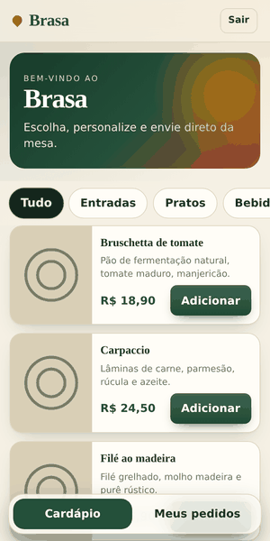
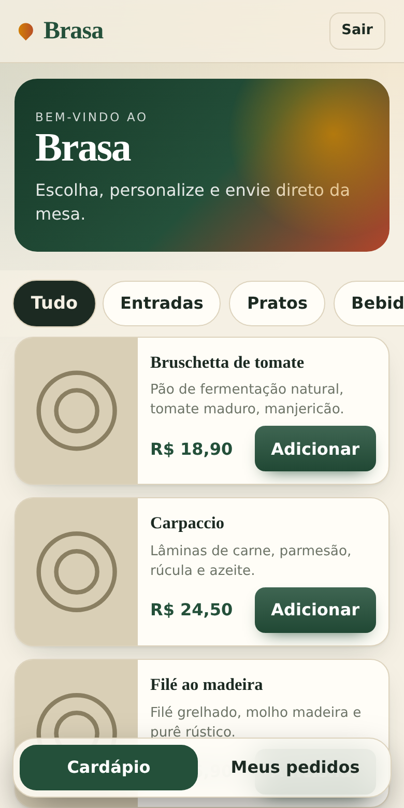
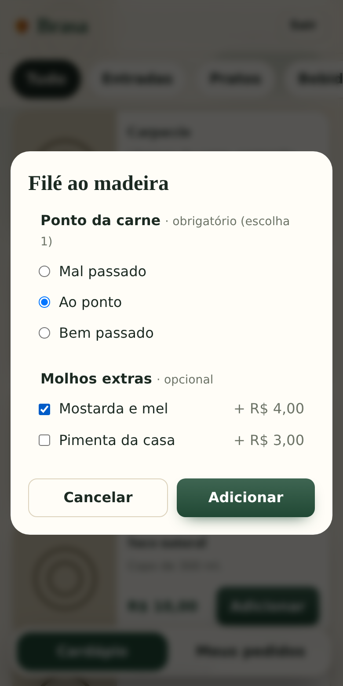
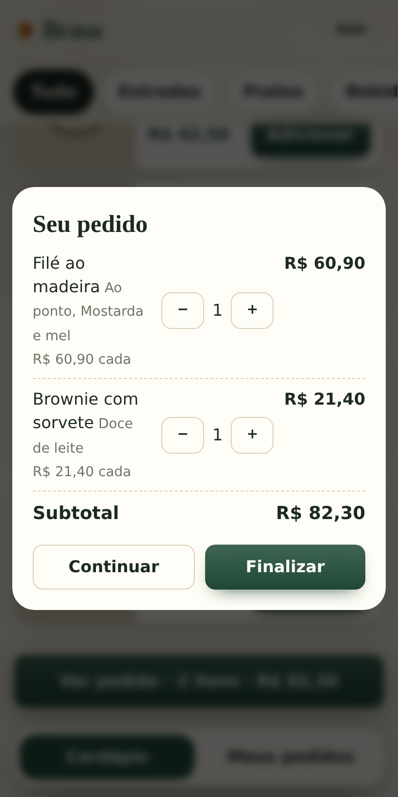
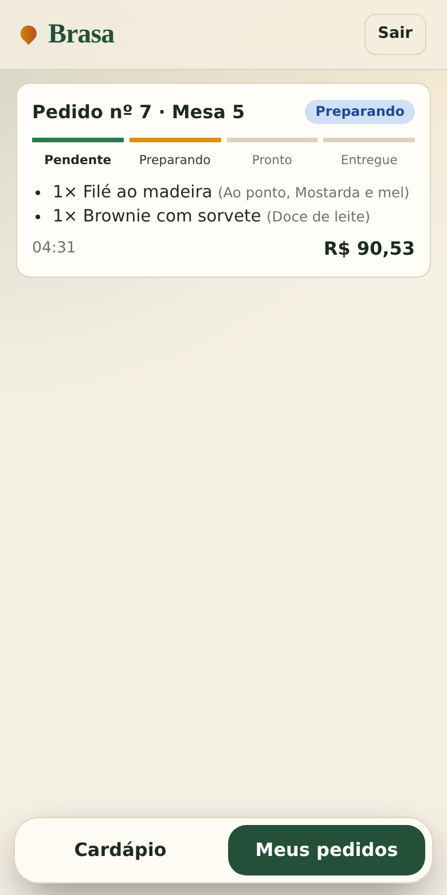
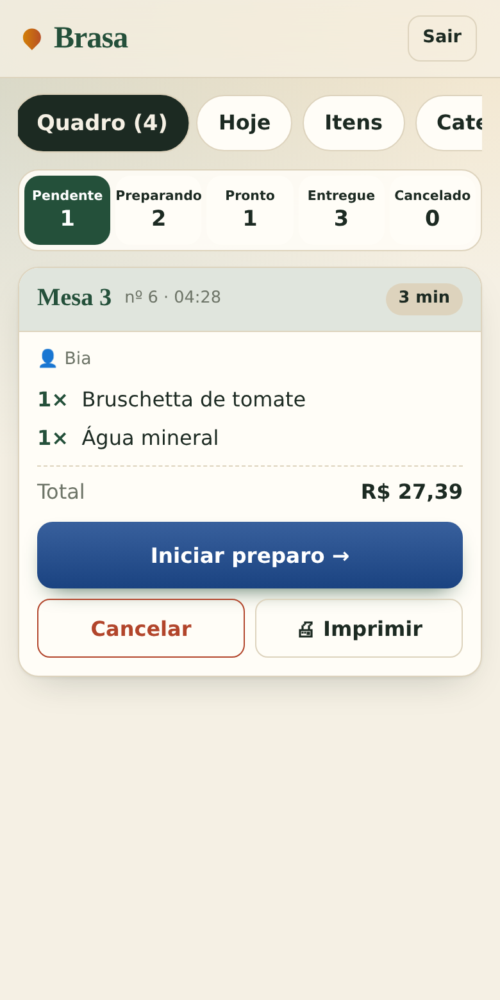
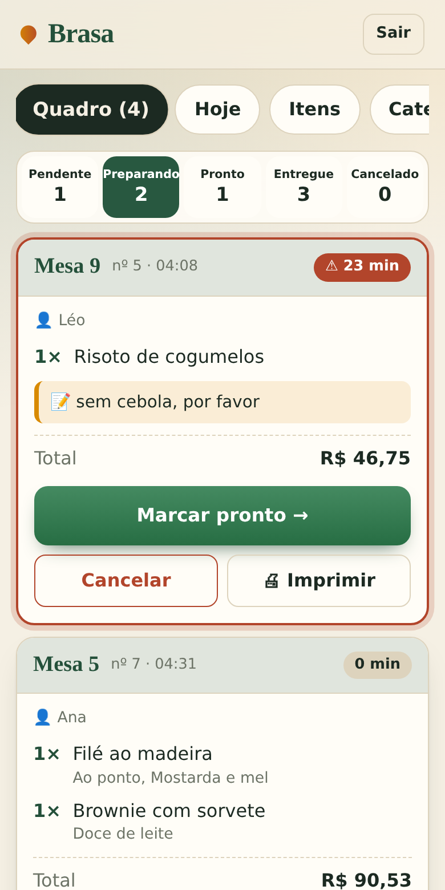
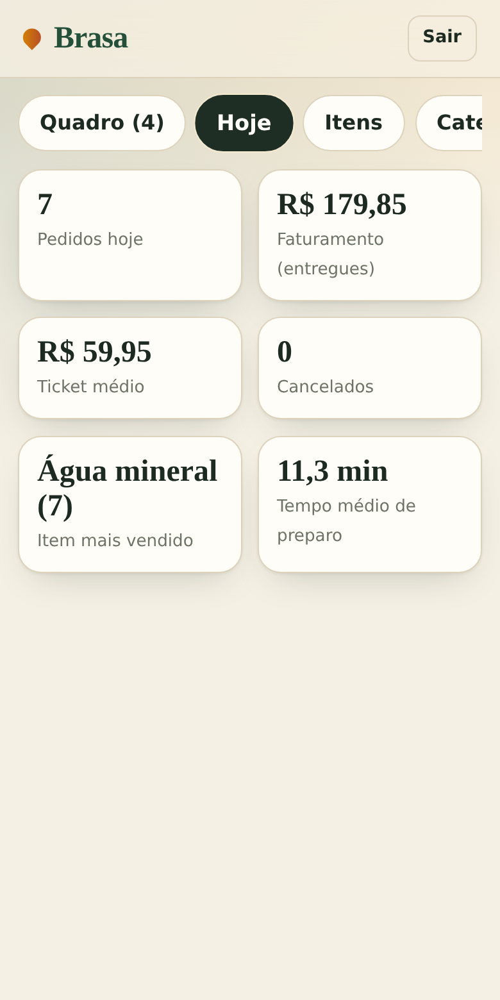
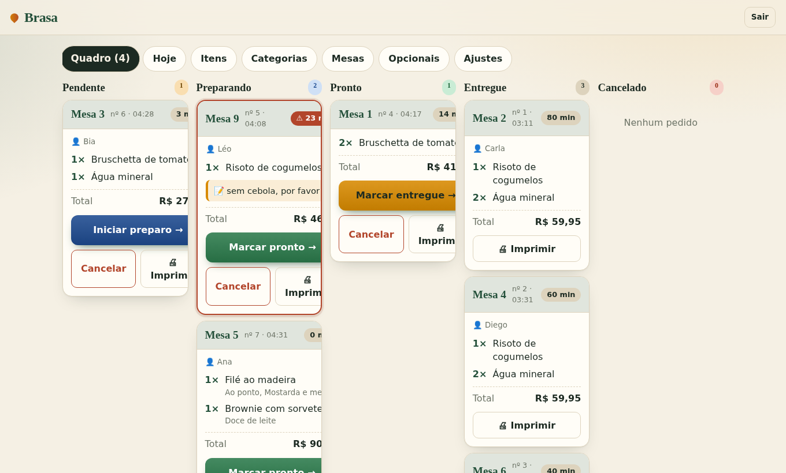
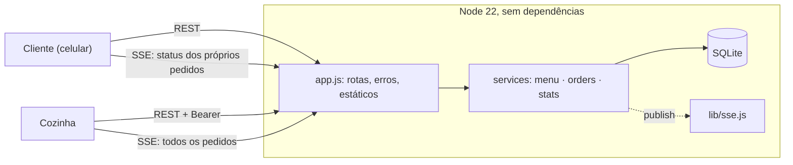

# 🍽️ Brasa — cardápio digital com pedidos em tempo real


Sistema de pedidos para restaurante, **pensado para celular**: o cliente abre o cardápio na mesa, monta o pedido e acompanha o preparo; a cozinha recebe tudo na hora, avança os status e vê as estatísticas do dia. Backend em Node **sem nenhuma dependência externa** (`node:http`, `node:sqlite`, `node:crypto`, SSE) e front em ES Modules **sem build**.



| Cardápio | Opções | Carrinho | Acompanhamento |
|---|---|---|---|
|  |  |  |  |

| Quadro da cozinha | Pedido atrasado (> 20 min) | Estatísticas do dia |
|---|---|---|
|  |  |  |



## Funcionalidades

**Cliente** — cardápio por categorias (foto padrão quando falta), opções obrigatórias (escolha única) e opcionais (múltipla) com preço extra, carrinho que soma itens iguais com as mesmas opções, taxa de serviço opcional e configurável, observações para a cozinha, acompanhamento em tempo real **só dos próprios pedidos**, itens indisponíveis ocultos.
**Cozinha/admin** — quadro Pendente → Preparando → Pronto → Entregue (+ Cancelado), alerta para pedido ativo > 20 min, aviso sonoro e visual a cada pedido novo, estatísticas (pedidos, faturamento, ticket médio, cancelados, item mais vendido, tempo médio de preparo), CRUD de itens, categorias, mesas e opcionais, impressão de comanda, troca de senha.

## Arquitetura



```
server/   index.js · app.js · db.js · lib/{http,validate,auth,sse}.js · services/{menu,orders,stats}.js
web/      index.html · css/style.css · js/{util,state,ui,rules,client,kitchen,actions,view,main}.js
test/     api.test.js (integração) · unit/util.test.js · e2e/e2e.py (Playwright)
docs/     capturas e GIF (gerados por scripts/capture-docs.py)
```

## Decisões técnicas (e por quê)

| Decisão | Motivo |
| --- | --- |
| **Dinheiro em centavos inteiros**, formatado com `Intl` (`R$ 1.234,56`) | Sem erro de ponto flutuante; taxa arredondada em centavos no servidor. |
| **Snapshot na linha do pedido** (nome, opções, preço unitário), sem FK para o item | Editar/excluir item não altera pedidos antigos nem estatísticas. |
| **O servidor recalcula todos os preços** | O cliente só envia ids e quantidades; preço adulterado no navegador não tem efeito. |
| Faturamento = soma de pedidos **entregues** | Cancelado nunca entra, então não há o que subtrair (nem subtrair duas vezes). |
| Categoria por **id** + `ON DELETE RESTRICT` | Renomear não gera órfãos; excluir com itens retorna 409. |
| **SSE** em vez de WebSocket | Fluxo é servidor→cliente; reconecta sozinho; zero dependência. Cliente recebe só `id+status` dos seus pedidos. |
| **Token por pedido** | O cliente só lê o que criou; sem login para quem está na mesa. |
| Escape automático no template tagged `h`, CSP `script-src 'self'` | XSS: todo texto de usuário é escapado na renderização; sem script inline. |
| ES Modules nativos, sem bundler | Zero etapa de build; o código roda como está. |

## Rodando

```bash
# Linux/macOS
KITCHEN_PIN=sua-senha npm start       # http://localhost:3000   (PORT, DB_FILE, TZ=America/Sao_Paulo)
```

```powershell
# Windows (PowerShell)
$env:KITCHEN_PIN="sua-senha"; npm start
```

```bash
npm run dev                            # recarrega ao editar o servidor
```

## Testes

```bash
npm test                # 20 testes: API de integração (servidor real + SQLite em memória) e unitários do front
npm run test:e2e        # 58 verificações ponta a ponta com 3 aparelhos simulados (pip install playwright && playwright install chromium)
```

O e2e cobre: layout em 375/320 px e desktop (sem rolagem lateral, alvos de toque ≥ 44 px, carrinho centralizado), fluxo completo cliente→cozinha→cliente em tempo real, isolamento entre clientes, snapshot de preços, estatísticas, pedidos de dias anteriores, XSS, senha, modo offline.

## API (resumo)

Público: `GET /api/menu` · `POST /api/orders` · `GET /api/orders?ids=ID.TOKEN,…` · `GET /api/stream?orders=ID.TOKEN,…`
Cozinha (`Authorization: Bearer`): `POST /api/auth/login` · `GET /api/admin/{catalog,orders,stats}` · `PATCH /api/admin/orders/:id {status}` · `PUT /api/admin/settings` · `POST|PUT|DELETE /api/admin/{cats,tables,groups,items}[/:id]` · stream `GET /api/stream?t=TOKEN`

## Limitações conhecidas

- `node:sqlite` ainda é experimental e atende **uma instância**. Para escalar: Postgres + Redis pub/sub no lugar de `db.js`/`lib/sse.js`.
- Mudanças no cardápio chegam ao cliente ao voltar ao app ou em até 20 s (só pedidos e status são push).
- Tokens do SSE vão na query (limitação do `EventSource`): use HTTPS.
- Impressão via `window.print` (72 mm); impressora térmica direta (ESC/POS) não implementada.
- **Deploy:** `Dockerfile` e workflow de CI incluídos, mas não foram executados no ambiente em que o projeto foi criado — valide no seu. Em hospedagens, monte um volume em `/data` (SQLite precisa de disco persistente).

## Roadmap

Upload de fotos · relatórios por período/CSV · PWA com push para a cozinha · reordenar categorias · impressão térmica · Postgres.

## Licença

MIT — veja [LICENSE](LICENSE).
